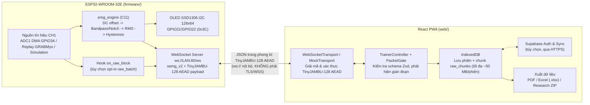

# SMART sEMG TRAINER

Hệ thống phần cứng nhúng **ESP32-WROOM-32E** và ứng dụng web PWA (**React + TypeScript**) hỗ trợ theo dõi tín hiệu điện cơ bề mặt (**sEMG 1 kênh `CH1`**), phản hồi sinh học theo thời gian thực, đếm số lần co–giãn cơ và xuất dữ liệu phục vụ luyện tập lẫn nghiên cứu.

> **Lưu ý quan trọng:** Ứng dụng chỉ phục vụ theo dõi luyện tập và nghiên cứu kỹ thuật sEMG. **Không dùng cho mục đích chẩn đoán y khoa, đánh giá bệnh lý hay chỉ định điều trị.**

---

## 1. Tổng quan hệ thống & Quy ước kênh `CH1`

- **1 kênh đo duy nhất (`CH1`):** toàn bộ luồng thu thập, DSP, giao diện và xuất dữ liệu hoạt động thống nhất trên **1 kênh `CH1`** (phần cứng đọc từ `GPIO34` / `ADC1_CH6`).
- **Vùng cơ là thông tin vị trí đặt điện cực:** lựa chọn `Cẳng tay` (`forearm`) hoặc `Bắp tay` (`biceps`) là siêu dữ liệu khai báo vị trí dán điện cực cho phiên tập trên `CH1`, **không phải** các kênh đo độc lập.
- **Ba dạng biểu diễn tuần tự trên cùng kênh `CH1`:**
  1. **Tín hiệu gốc (`RAW`):** mẫu ADC thô (`raw_adc_codes`) trước khi lọc số, chỉnh lưu hay tính RMS (trên cảm biến thật vẫn đã đi qua mạch tiền khuếch đại analog INA333 + MCP601).
  2. **Tín hiệu lọc số (`ch1_filtered`):** tín hiệu `CH1` sau bước triệt DC offset số, lọc thông dải Butterworth 20–450 Hz và tùy chọn notch 50/60 Hz.
  3. **Biên độ `RMS / envelope` (`ch1_rms_envelope`):** giá trị RMS theo cửa sổ trượt của `CH1` dùng để hiển thị đồ thị, đánh giá vùng mục tiêu và đếm chu kỳ Co – Giữ – Thả.

---

## 2. Kiến trúc truyền thông & xử lý



> **Phân biệt bảo mật lớp ứng dụng và TLS/WSS:** Giao tiếp LAN với ESP32 sử dụng `ws://` (không có TLS/WSS trên ESP32) và **mã hóa + xác thực từng payload** bằng thuật toán **TinyJAMBU-128 AEAD** (`semg_v2:s2c` và `semg_v2:c2s`). Vì trình duyệt chặn `ws://` bên trong trang `https://` (mixed content), kết nối trực tiếp tới ESP32 qua LAN cần chạy Web App qua `http://` trong mạng tin cậy (hoặc qua gateway TLS hợp lệ nếu host HTTPS).

---

## 3. Thông số kỹ thuật thực tế trong mã nguồn

| Thành phần | Giá trị xác minh từ code | Nguồn tham chiếu |
|---|---|---|
| Vi điều khiển & mục tiêu | **ESP32-WROOM-32E** (`target = esp32`, Flash `4 MB`, FreeRTOS `1000 Hz`) | [sdkconfig.defaults](firmware/sdkconfig.defaults), [idf_component.yml](firmware/main/idf_component.yml) |
| Kênh ADC phần cứng | 1 kênh `GPIO34` (`ADC_UNIT_1`, `ADC_CHANNEL_6`), `12-bit`, `ADC_ATTEN_DB_12` | [emg_adc.c](firmware/main/emg_adc.c), [emg_adc.h](firmware/main/emg_adc.h) |
| Lấy mẫu phần cứng (`TR_ADC`) | Oversampling `16×` ở `32.768 Hz` → decimation ra `2048 Hz` (`64` mẫu/`31,25 ms`) | [emg_adc.h](firmware/main/emg_adc.h) |
| Quy đổi điện áp & AFE | `esp_adc/adc_cali` Line Fitting (fallback `805,86 µV/count`), gain mặc định `400,0` (INA333 + MCP601), ước lượng DC offset `1500 ms` đầu | [trainer.h](firmware/main/trainer.h), [emg_adc.c](firmware/main/emg_adc.c) |
| Tần số nguồn khác | Firmware `TR_REPLAY` / `TR_SIMULATION`: `2048 Hz`; Web `SimulationEngine`: `1000 Hz` | [config.c](firmware/main/config.c), [engine.ts](web/src/core/engine.ts) |
| Lọc số DSP (`TR_RAW`) | Butterworth bandpass bậc 4 `20–450 Hz`, tùy chọn notch `0 / 50 / 60 Hz` (`Q = 30`) | [config.c](firmware/main/config.c) |
| Cửa sổ RMS & Hiệu chuẩn | Cửa sổ trượt `100,1 ms` (firmware) / `100 ms` (mô phỏng web); hiệu chuẩn nghỉ `5000 ms` (settle `500 ms`) / `2500 ms` (mô phỏng web) | [config.c](firmware/main/config.c), [engine.ts](web/src/core/engine.ts) |
| Phát hiện co–giãn | Hysteresis (`on_factor = 1,8`, `off_factor = 1,3`, `on_sd = 4`, `off_sd = 2`), debounce firmware `125 ms / 218,75 ms` (web mock `200 ms / 200 ms`), giữ mặc định `500 ms`, mục tiêu `5` lượt, tối đa `128` lượt/phiên firmware | [config.c](firmware/main/config.c), [trainer.h](firmware/main/trainer.h), [engine.ts](web/src/core/engine.ts) |
| OLED hiển thị | SSD1306 I²C `128×64`, `SDA = GPIO21`, `SCL = GPIO22`, địa chỉ `0x3C`, `100 kHz` | [emg_ui_config.h](firmware/main/emg_ui_config.h) |
| Công cụ Web | Node.js `v24.16.0` (CI Node `22`), React `19.1.1`, TypeScript `~5.9.2`, Vite `7.1.7`, Vitest `3.2.4` | [package.json](web/package.json), [ci.yml](.github/workflows/ci.yml) |

### Ba nguồn tín hiệu được hỗ trợ
1. **`simulation` (Mô phỏng):** tạo tín hiệu tổng hợp trong Firmware hoặc `SimulationEngine` trên trình duyệt, phục vụ kiểm thử UI/giao thức không cần điện cực.
2. **`replay` (Phát lại GRABMyo v1.1.0):** phát lại đoạn mẫu `30.720` mẫu @ `2048 Hz` trích từ kênh vật lý `F1` của bộ dữ liệu GRABMyo (nghỉ 5 s → co 5 s → nghỉ 5 s).
3. **`sensor` (Đo ADC thực tế):** đọc trực tiếp từ `GPIO34` qua ADC1 DMA trên ESP32 kèm thông số hiệu chuẩn `conversion` (hoặc số đếm `ADC` thô `0–4095`).

---

## 4. Tính năng Xuất dữ liệu

Nút **“Xuất dữ liệu”** (trong chi tiết buổi tập tại **Lịch sử** hoặc từ bản chụp khi đang đo) mở hộp thoại với 2 hướng xuất:

1. **Báo cáo buổi tập (cho người dùng cuối):**
   - **PDF (`.pdf`, khổ A4, tiếng Việt đầy đủ dấu qua DejaVu Sans):** gồm phần tổng kết (bắt đầu, thời lượng, chế độ, `CH1` + vị trí đặt điện cực, nguồn dữ liệu, mục tiêu/tổng ghi nhận/hợp lệ/không hợp lệ, phân biệt tách bạch *mức hoàn thành mục tiêu* và *tỷ lệ lần co hợp lệ* với mẫu số bằng `0`), biểu đồ vector `RMS/envelope` + lịch sử thay đổi ngưỡng + đánh dấu sự kiện đạt/chưa đạt, bảng chi tiết từng lần co cơ và khuyến cáo không chẩn đoán y khoa.
   - **Excel (`.xlsx`, OOXML chuẩn):** gồm các sheet `Tổng kết`, `Từng lần co cơ` và `Dữ liệu biểu đồ` (chỉ tạo khi có chuỗi tín hiệu thật; giữ đúng kiểu số/ngày giờ, cố định hàng tiêu đề và bật bộ lọc).
   - **Tài liệu mẫu tạo từ hệ thống thật (dữ liệu mô phỏng demo):** [sample_training_report_demo.pdf](docs/samples/sample_training_report_demo.pdf).
2. **Dữ liệu nghiên cứu — RAW (`.zip`):**
   - **`signal_raw.csv`:** `sample_index`, `time_s` (suy ra từ `sample_index / fs_hz`, không nội suy qua đoạn mất mẫu), `ch1_adc` (và `ch1_uV` chỉ khi có đủ metadata hiệu chuẩn). **Chỉ xuất hiện khi người dùng bật tùy chọn opt-in “Ghi dữ liệu RAW cho nghiên cứu”**; ứng dụng không bao giờ đổi tên `RMS/envelope` thành `RAW` hay tạo `RAW` giả từ dữ liệu đã xử lý.
   - **`events.csv`:** các sự kiện đã xác nhận và sự kiện `incomplete` nếu dừng/xuất giữa chừng; quy ước khoảng mẫu nửa mở `[start_sample_index, end_sample_index)`, mã lý do và `label_source = algorithm_predicted` (không coi là ground truth).
   - **`metadata.json`:** ghi rõ `electrode_placement`, `signal_representations_on_ch1`, cấu hình ADC/DSP, lịch sử thay đổi ngưỡng, thông tin replay (nếu có), cơ chế theo dõi mất mẫu (`tracked_by_source_sample_index` hoặc `not_tracked`) và giữ `null` cho thông số phần cứng không đo được.
   - **`README.txt`:** hướng dẫn tiếng Việt kèm snippet đọc dữ liệu mẫu bằng Python (`pandas`) và MATLAB (`readtable`).
   - **`signal_processed.csv` (tùy chọn):** xuất riêng `ch1_filtered`, `ch1_rms_envelope`, ngưỡng và vùng mục tiêu theo nhịp khung hiển thị (tách khỏi `signal_raw.csv` do khác tốc độ lấy mẫu).

> *Ghi chú tài sản trực quan:* Repo hiện có [báo cáo PDF mẫu sinh từ dữ liệu mô phỏng](docs/samples/sample_training_report_demo.pdf). Chưa kèm ảnh chụp màn hình điện thoại thật và ảnh mạch ESP32/OLED ngoài đời thực.

---

## 5. Cấu trúc thư mục

```text
smart-semg-trainer/
├── .github/workflows/ci.yml   # GitHub Actions: Web CI & Firmware native C11 tests
├── docs/
│   └── samples/               # Báo cáo PDF mẫu tạo từ nguồn mô phỏng demo
├── firmware/                  # Mã nguồn ESP-IDF ESP32-WROOM-32E (xem firmware/README.md)
│   ├── main/                  # ADC1 DMA, DSP engine, OLED SSD1306, TinyJAMBU WS server
│   ├── tests/                 # Bộ test C11 host (run_tests.py + stubs)
│   ├── docs/                  # Tài liệu validation & trích dẫn GRABMyo
│   ├── CMakeLists.txt
│   ├── partitions.csv
│   └── sdkconfig.defaults
├── scripts/windows/           # Script chạy nhanh Windows (.vbs / .bat dùng đường dẫn tương đối)
├── web/                       # Ứng dụng React + TypeScript + PWA (xem web/README.md)
│   ├── src/                   # core, transports, storage/export, hooks, components
│   ├── public/                # manifest, icons PWA, offline fallback, fonts DejaVu Sans
│   ├── scripts/               # Service worker builder, ESP32 WS emulator, kiểm tra WS AEAD
│   ├── supabase/              # PostgreSQL schema & RLS (tùy chọn)
│   └── tests/                 # 80 unit & integration tests (Vitest)
├── .gitignore
├── LICENSE                    # MIT License cho phần mã nguồn dự án
├── THIRD_PARTY_NOTICES.md     # Giấy phép TinyJAMBU, GRABMyo v1.1.0 (CC BY 4.0), DejaVu Fonts
└── README.md
```

---

## 6. Hướng dẫn cài đặt, chạy và kiểm thử (Windows PowerShell)

### Bước 1: Tạo file cấu hình cục bộ từ file mẫu (nếu cần)

- **Firmware (bắt buộc khi nạp ESP32 thật kết nối Wi-Fi):** chạy từ `firmware/`:
  ```powershell
  cd firmware
  copy main\emg_ui_secrets.example.h main\emg_ui_secrets.h
  ```
  Mở `firmware\main\emg_ui_secrets.h` điền `EMG_WIFI_SSID`, `EMG_WIFI_PASSWORD` và đặt lại khóa 32 ký tự hex `EMG_WS_AEAD_KEY_HEX` cho môi trường thật (giá trị `000102030405060708090a0b0c0d0e0f` là khóa công khai chỉ dùng để dev/test).
- **Web Supabase (không bắt buộc — mặc định chạy hoàn toàn cục bộ bằng IndexedDB):** chạy từ `web/`:
  ```powershell
  cd web
  copy .env.example .env.local
  ```
  Chỉ dùng *anon/publishable key*; tuyệt đối không dùng `service_role`.

### Bước 2: Chạy và build Web App (từ thư mục `web/`)

Yêu cầu Node.js >= 22:

```powershell
cd web
npm ci
npm run dev
```

Mở `http://localhost:4173` và dùng nguồn **Mô phỏng** ngay trên trình duyệt. Để kiểm tra build production hoặc dùng launcher Windows ở `scripts\windows\`:

```powershell
cd web
npm run build
npm run emulator
```

- Khi đã có bản build `web\dist\`, có thể nhấp đúp `scripts\windows\Chay_Ngam_Cho_Dien_Thoai.vbs` hoặc `Mo_App_sEMG_Khong_Terminal.vbs` (tự nhận đường dẫn từ vị trí script, không phụ thuộc ổ đĩa hay tên user). Đóng server nền bằng `scripts\windows\Tat_Server_Ngam.bat`.

### Bước 3: Biên dịch & nạp Firmware ESP32 thật (từ thư mục `firmware/`)

Mở **ESP-IDF Terminal** (ESP-IDF `>= 5.3`, đã khóa target `esp32` trong `sdkconfig.defaults`):

```powershell
cd firmware
idf.py set-target esp32
idf.py build
idf.py -p COM8 -b 115200 flash monitor
```

Thay `COM8` bằng cổng COM thực tế. Sau khi ESP32 vào Wi-Fi 2.4 GHz, xem địa chỉ IP trên Serial Monitor rồi nhập thủ công vào tab **Thiết bị** trên Web App (trường IP mặc định để trống với placeholder ví dụ `192.168.1.55`, ứng dụng không tự động kết nối nếu chưa nhập địa chỉ hợp lệ).

### Bước 4: Chạy các bộ kiểm thử

```powershell
# Kiểm thử Web App (chạy tại thư mục web/)
cd web
npm run check      # TypeScript typecheck
npm test           # Vitest (chạy 1 lần, không watch mode)
npm run build      # Build production + PWA service worker
npm run test:ws    # Kiểm thử WebSocket TinyJAMBU-128 AEAD với emulator local

# Kiểm thử Firmware C11 trên host (chạy tại thư mục firmware/)
cd ..\firmware
python tests/run_tests.py
```

*(Nếu dùng ESP-IDF Python trên Windows, thay `python` bằng `C:\Espressif\tools\python\python.exe`.)*

---

## 7. Giới hạn đã biết

- Bộ kiểm thử native C (`tests/run_tests.py`) biên dịch trên host PC (GCC C11) để kiểm tra logic DSP, bộ lọc, decimation 16×, OLED framebuffer và giao thức; **không thay thế** lệnh biên dịch mục tiêu `idf.py build` của ESP-IDF hay kiểm thử trực tiếp trên bo ESP32-WROOM-32E thật.
- Lưu trữ cục bộ dữ liệu RAW trên trình duyệt là opt-in và bị giới hạn tối đa ~50 MB/phiên để tránh tràn bộ nhớ thiết bị di động.
- Nền tảng host HTTPS không thể kết nối trực tiếp tới `ws://` nội bộ của ESP32 trừ khi chạy qua HTTP mạng tin cậy hoặc bố trí gateway TLS/WSS.

---

## 8. Ghi nhận & Giấy phép

- Mã nguồn do dự án phát triển được cấp phép theo **MIT License** — xem [LICENSE](LICENSE).
- Toàn bộ thông báo bản quyền và giấy phép bên thứ ba (**TinyJAMBU-128**, **GRABMyo v1.1.0 CC BY 4.0 DOI 10.13026/89dm-f662**, **DejaVu Fonts**) được ghi đầy đủ trong [THIRD_PARTY_NOTICES.md](THIRD_PARTY_NOTICES.md).
